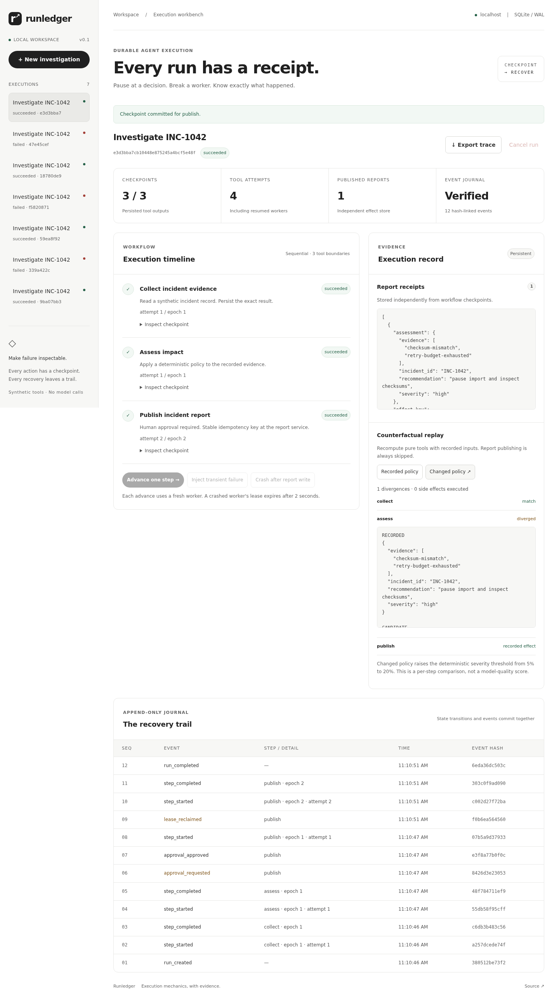

# Runledger

**Inspect, approve, break, and recover a tool workflow — with a durable record of what happened.**

Runledger is a local execution workbench for explicit agent tool plans. It persists each step,
pauses side effects for human review, rejects stale workers, and compares alternative tool behavior
against recorded inputs. The interesting moment is a worker disappearing **after a report has
been published but before its checkpoint is committed**. The demo recovers that run and shows one
report receipt alongside two publish attempts.



The neutral interface keeps approval, recovery and evidence readable on desktop and mobile. See [UI design and verification](docs/ui-design.md) for the visual refresh and regression checks.

## Run it

Python 3.11+ is the only runtime requirement. No model, API key, database server, or cloud account
is needed. The included tools operate on clearly labeled synthetic incident data.

```bash
git clone https://github.com/leodevnc/runledger.git
cd runledger
python -m runledger serve
```

Open **http://127.0.0.1:8765**. State is saved in `.runledger/` and survives server restarts.

For a complete scripted failure-and-recovery demonstration:

```bash
python -m runledger demo
```

Expected evidence: one receipt exists immediately after the injected failure; the publish step
still has no checkpoint; recovery succeeds; the receipt count remains one; the event journal
records a lease takeover. Counterfactual replay then exposes one changed assessment without
publishing another report.

## The two-minute walkthrough

1. Create an investigation and advance through **collect** and **assess**.
2. Advance again to request approval. Inspect the exact proposed report and its action digest.
3. Approve, then select **Crash after report write**.
4. Observe **1 published report** but only **2 / 3 checkpoints**.
5. After the two-second lease expires, advance with a new worker.
6. Observe **3 / 3 checkpoints**, **4 tool attempts**, and still **1 report**.
7. Compare the changed policy and export the trace to inspect all transitions.

The browser fault button simulates worker loss inside the local server. A separate automated test
actually terminates a child process with `os._exit()` at the same failure boundary.

## What is implemented

| Concern | Mechanism | Observable evidence |
| --- | --- | --- |
| Durable execution | Immutable submitted plan and per-step checkpoints | Restart and continue an existing run |
| Worker ownership | Expiring leases and monotonically increasing epochs | Old worker completion rejected |
| Ambiguous side effects | Stable idempotency keys checked by a separate report database | Two attempts, one durable receipt |
| Human decisions | Approval bound to plan, resolved arguments, step and tool version | Changed payload needs a fresh approval |
| Bounded recovery | Retry delay and a maximum of three attempts | Transient retries terminate when exhausted |
| Inspectability | State change and event append share a transaction | Ordered journal with hashes and reason codes |
| Replay comparison | Recompute pure tools with recorded inputs | Changed outputs highlighted; effects skipped |

The code is divided into a durable store, worker, tool registry, local report sink, replay engine,
HTTP operator console, and browser UI. The core and HTTP layer use the Python standard library;
the frontend has no build step. Chromium is an optional development dependency for browser tests.

## Tests and recorded evidence

```bash
python -m unittest discover -s tests -v
python -m runledger.evaluate --repeats 10
```

The [recorded failure matrix](docs/evaluation-results.json) contains 50 runs across healthy
execution, post-effect worker loss, transient retry, approval rejection, and cancellation.
All 50 met their expected state/effect invariants; no duplicate effects were observed.
These are synthetic execution tests, not model-quality results or production scale measurements.

Browser checks:

```bash
npm ci
npx playwright install chromium
npm run test:e2e
```

See [test evidence](docs/test-evidence.md) for environment, results, and limits. A
[CI template](ci/github-actions.yml) is included outside `.github/workflows`; hosted CI is not active.

## Bring an explicit tool plan

```bash
python -m runledger create examples/incident-workflow.json --request-id investigation-1042
python -m runledger list
python -m runledger inspect RUN_ID
python -m runledger tick RUN_ID
python -m runledger approve RUN_ID publish APPROVAL_HASH
```

The plan contract is intentionally small: an ordered list of allowlisted tool calls with references
to earlier outputs. Tool names, schemas, versions, and approval requirements are server-owned.
A planner cannot turn off approval or submit shell code. The first milestone does not implement
an LLM reasoning loop or call a model provider. A model-produced plan would need validation against
this same contract; connecting a planner is a separate integration step.

## Engineering record

- [Architecture and transaction boundaries](docs/architecture.md)
- [Design decisions and rejected alternatives](docs/decisions.md)
- [Failure walkthrough and debugging guide](docs/failure-guide.md)
- [Learning notes](docs/learning-notes.md)
- [Roadmap](docs/roadmap.md)

## Scope

Runledger is a single-host prototype with a loopback-only operator UI and local file access as its
trust boundary. It has no user authentication, tenant isolation, distributed database, automatic
worker pool, model sandbox, or OpenTelemetry exporter. The UI advances one step at a time so each
failure boundary stays visible.

SQLite serializes writers. The included tools are short-running; a real long-running adapter must
renew its lease and enforce its own timeout. The idempotent report sink is an explicit downstream
contract, **not a general exactly-once guarantee**. Cancellation fences future checkpoints but
cannot undo an effect already sent. Hash-linked events detect accidental changes when the expected
chain is retained; they are not signed, externally anchored, or immutable against a database owner.

## License

MIT
