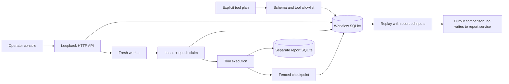
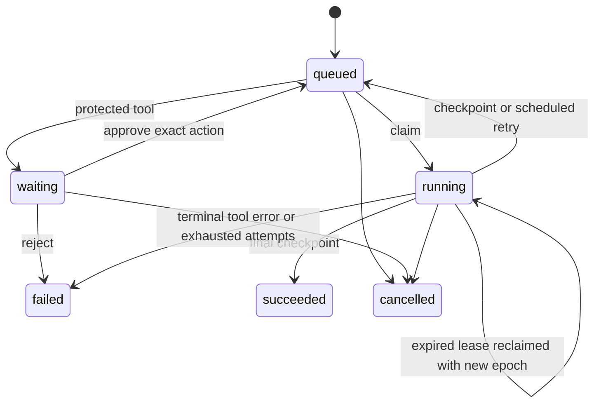

# Architecture

## State machine

Workflows are serial; independent runs can execute concurrently. A submitted plan and its tool
versions are retained. Step references must target an earlier, compatible tool output. Runs are
deduplicated by a caller-supplied request ID; changing the plan behind the same ID is a conflict.

## Four separate boundaries

1. **Claim transaction.** `BEGIN IMMEDIATE` serializes contenders. Read the first incomplete step,
   check policy/approval/readiness, and increment its epoch before committing ownership.
2. **Tool execution.** Runs outside the workflow transaction. The external-effect simulator has
   its own database and commit, so it cannot accidentally inherit workflow atomicity.
3. **Checkpoint transaction.** Match run, step, owner, epoch, running state, and live lease. Commit
   the result and journal event together. A stale worker cannot complete, renew, or fail the step.
4. **Downstream idempotency.** A report key is `run_id:step_id`, stable across attempts. The sink
   atomically records the payload digest and receipt. Duplicate identical calls return the original
   receipt; reusing a key with different inputs fails.

A crash between boundaries 2 and 3 leaves a durable report without a durable checkpoint. A later
worker repeats the tool call with the same key, receives the existing receipt, and checkpoints it.
This is at-least-once execution with a cooperating downstream service, not exactly-once execution
of arbitrary tool code. See SQLite's [transaction documentation](https://www.sqlite.org/lang_transaction.html)
and [isolation documentation](https://www.sqlite.org/isolation.html) for the storage mechanisms.

## Approval binding

The protected-tool list is server-owned. The proposal digest binds the submitted plan hash, step
ID, resolved arguments, and tool version. Approval changes only the waiting action it identifies.
An altered upstream result produces a new digest and reopens approval. Repeating the same decision
does not append duplicate events. Rejection makes the run terminal.

The local UI's operator label is an audit label, not authenticated identity. A production service
would have to authorize the actor and resource before this transaction.

## Retry, clocks, and cancellation

Transient failures use bounded exponential delay and at most three attempts. Lost workers consume
attempts too, so continuous process loss cannot retry forever. The default worker lease is ten
seconds; the interactive demo uses two seconds. Tests inject a clock to avoid waiting through
recovery windows. A process-exit test uses a real child process with a controlled lease clock.

Leases use host wall time. Clock jumps and deployment clock discipline require a stronger design
before multi-host operation. There is a renewal API, but no automatic heartbeat thread for slow
tools. A tool that exceeds its lease cannot checkpoint until safely retried.

Cancellation increments outstanding epochs and prevents future workflow progress. An already
issued external request may still complete. The boundary test cancels immediately after the sink
commit and verifies that the checkpoint is rejected while the receipt remains visible.

## Event journal and replay

Each transition appends a per-run sequence number, timestamp, typed payload, previous hash, and
current hash in the same transaction as its state change. Export includes plan, versions, steps,
events, and effect receipts. The verification flag checks the event chain. It does not independently
prove all database state or detect removal of an unanchored suffix.

Replay is intentionally a per-step comparison: completed pure tools are recomputed using their
recorded inputs; effects are represented by recorded receipts only. Alternative upstream output
is not propagated into downstream tools. The changed-policy preset raises the deterministic
assessment threshold from 5% to 20%; it is an execution-diff demonstration, not an LLM evaluation.

## HTTP boundary

The console binds only to `127.0.0.1`. It rejects foreign Host/Origin headers, requires JSON and a
custom header for writes, caps request size, and serves only a fixed static-file allowlist. UI data
is inserted with `textContent`, and CSP disallows inline scripts and framing. These controls limit
browser-origin mistakes; they do not provide authentication against another local process.
